# 包裹管家 · PackKeeper

> **多账号代购的包裹与订单对账工具** —— Android 单机版 + PC 本地只读报表
>
> 到货扫码 → 待认领池 → 分配平台账号 → 代下单/补单号 → 打包转寄 → 快递费与净利润对账

<p>
  
  
  
  
  
</p>

---

## 一、产品简介

大量包裹到货时，运单号只能证明「有一个包裹」，却很难回答「这是哪个平台、哪个账号、哪笔订单、什么商品」。

包裹管家把这条链路串起来，全部数据保存在手机本地，不联网、不保存平台密码、不做自动登录与爬虫：

```text
① 到货入库            ② 认领归属              ③ 订单回填               ④ 转寄上家              ⑤ 对账
扫码/手输/面单  →  待认领池（就是单号）  →  代下单登记，补单号  →  勾选包裹建批次   →  概览：快递费、净利润
     ↓                    ↓                      ↓                      ↓                    ↓
 生成包裹记录      分配平台账号后入库      从池子选单号绑定包裹    填快递费/运单号      Web 后台导入备份核对
```

---

## 二、界面预览

> 以下均为真机截图（Android 14，1200×2670），对应构建号 4023。

| 概览 · 快捷操作置顶 | 待认领池 | 订单列表 | 转寄批次 |
| :---: | :---: | :---: | :---: |
| 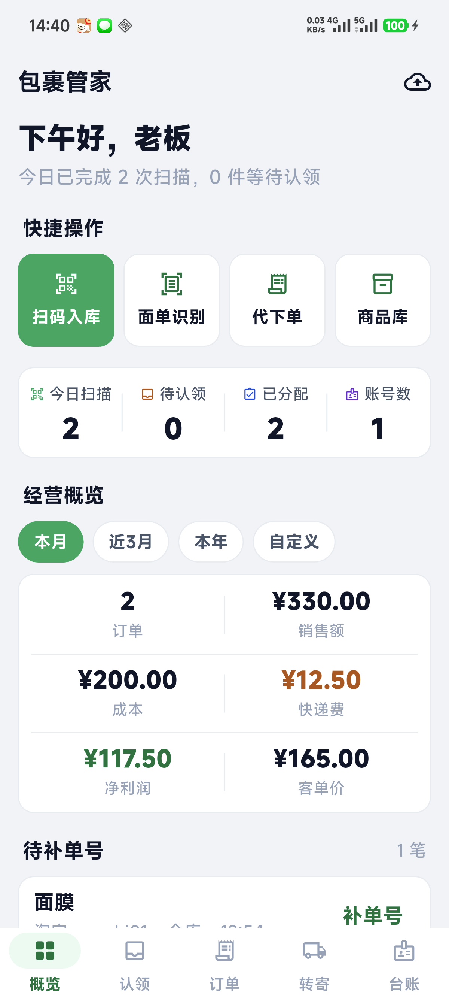 | 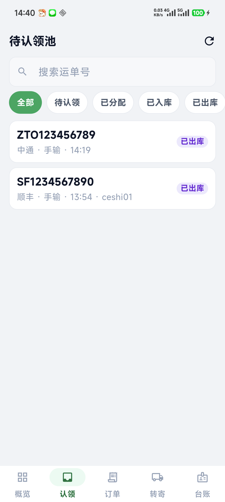 | 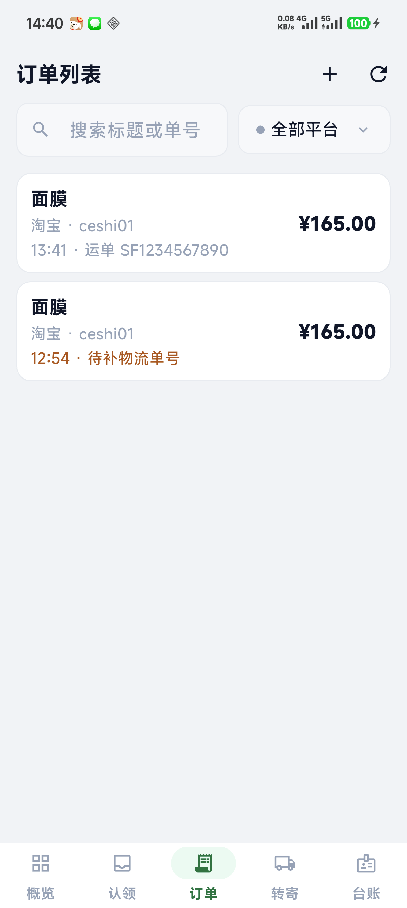 | 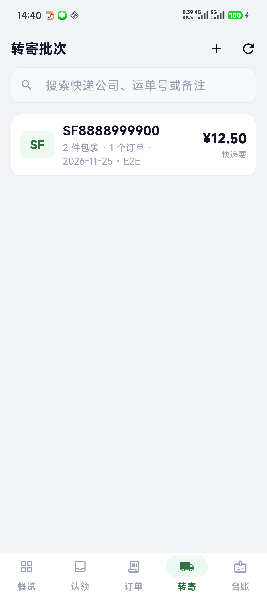 |
| 今日指标 + 经营概览 + 待补单号 | 单号池，多选批量分配 | 左滑补单号，可从池子选 | 批次卡片显示件数/订单数/快递费 |

| 台账（平台/账号） | 批次详情（含关联订单） | 扫码入库 | 补单号弹窗（扫码/选择/取消/保存） |
| :---: | :---: | :---: | :---: |
| 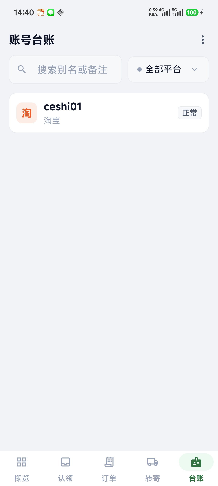 | 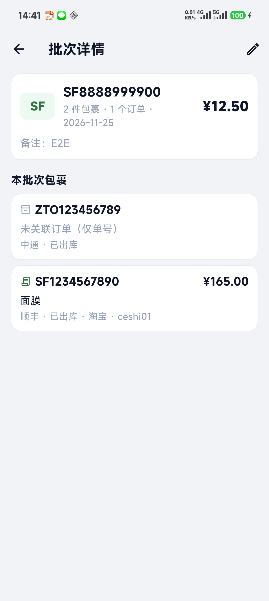 | 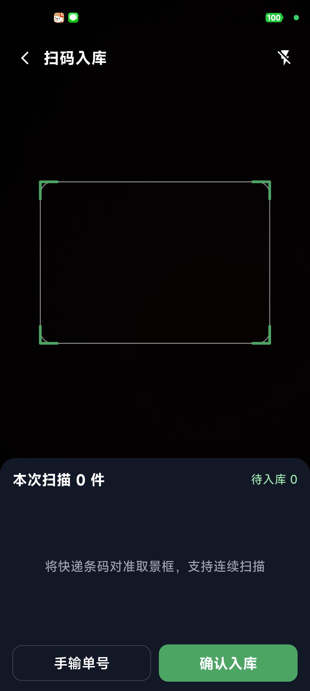 | 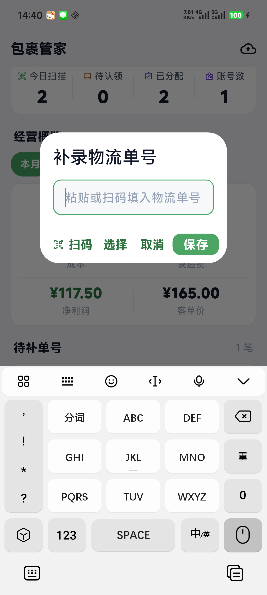 |
| 平台与账号统一管理 | 逐件核对商品、平台、金额 | 连续扫码，重复单号震动提示 | 四个按钮并列一行 |

### Web 本地报表

> PC 端报表截图（1440×900），导入手机备份后的只读视图。

| 经营概览 | 订单 | 转寄批次 |
| :---: | :---: | :---: |
| 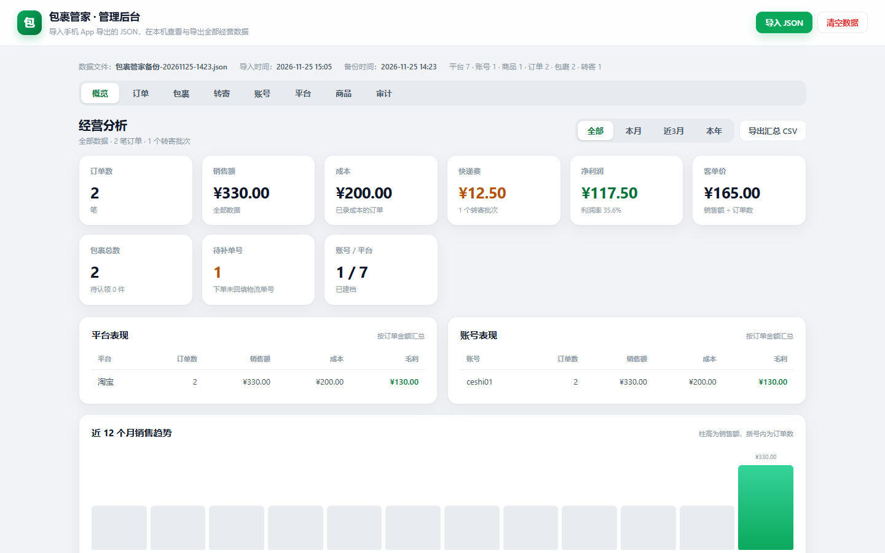 | 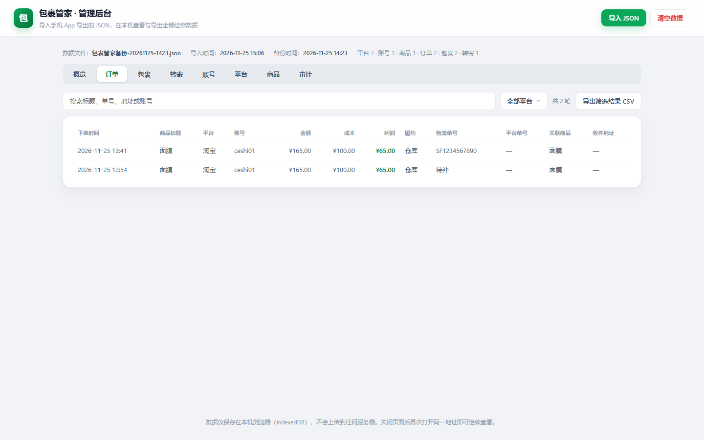 | 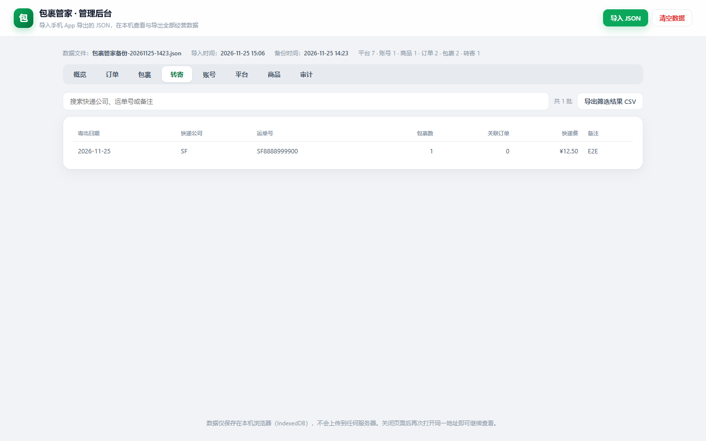 |
| KPI、平台与账号表现、近 12 月趋势 | 金额、利润、路径、物流单号、关联商品 | 批次、包裹数、关联订单、快递费 |

> 交互设计稿（11 屏静态预览）：[design/mvp-ui.html](./design/mvp-ui.html)，浏览器直接打开即可。

---

## 三、核心能力

### 3.1 概览

- **快捷操作置于页面顶部**：扫码入库、面单识别、代下单、商品库四个入口紧跟问候语，进入即可一键触达。
- 今日扫描、待认领、已分配、账号数四项指标一卡等分展示。
- 经营概览：订单数、销售额、成本、**快递费**、**净利润（销售额 − 商品成本 − 快递费）**、客单价，两列排布，金额自动缩放。
- 区间切换：全部 / 本月 / 近 3 月 / 本年 / 自定义（中文日期范围选择器）。
- 待补单号看板：集中补录未回填物流单号的订单，支持**扫码填入**、从待认领池选择或手动输入。

### 3.2 认领

- 待认领池本质是「单号池」：扫码、手输、面单识别产生的包裹都先进这里。
- 状态筛选：全部 / 待认领 / 已分配 / 已入库 / 已出库 / 异常件。
- 搜索、左滑删除（二次确认）、选中多件批量分配平台账号。
| 分配后包裹从「待认领」变为「已分配」，归属清晰；对已入库/已出库的包裹重新分配只更新账号，状态不回退；异常件重新分配会恢复标记异常前的进度状态。 |

### 3.3 订单

- 代下单记录：平台账号、商品、金额、成本、地址、物流单号、仓库/直送。
- 单笔登记与按行批量粘贴建单；商品库可带出成本与售价。
- **补单号与认领池联动**：未回填物流单号的订单可左滑「补单号」，概览看板同样可补录；支持**扫码填入**、从待认领池挑选单号或手动输入。保存后自动绑定包裹（同号包裹直接关联，未到货生成影子包裹，扫码入库自动合并）。
- 补单号扫码若命中库中包裹，会提示「已在库中（状态），保存后自动绑定」。
- 左滑删除订单（二次确认，已关联包裹保留并解除关联）。

### 3.4 转寄

- 一次寄件 = 一个批次：勾选本次寄出的包裹，填写快递公司、运单号、**总快递费**、寄出日期、备注。
- 批次卡片显示「N 件包裹 · M 个订单 · 日期」与批次快递费。
- **点击批次进入详情**：逐件查看包裹对应的商品订单、平台账号与金额，不再只有一串单号。
- **编辑批次可追加/移出包裹**：已在本批次的包裹默认勾选，取消勾选即移出（恢复已入库），新勾选即追加（置为已出库）。
- 删除批次：包裹保留并恢复「已入库」，快递费同步从统计中扣除。

### 3.5 台账

- 平台：预置 京东 / 淘宝 / 抖音 / 拼多多 / 小红书 / 1688 / 其他，可新增、重命名、删除（平台下有账号时拒绝删除）。
- 账号：别名、所属平台、启用状态、备注；不保存平台密码、不记录归属人。
- 编辑/删除统一放在卡片左滑层；删除账号时其包裹退回待认领池。

### 3.6 扫码反馈

- 扫码入库、批量录单、补单号取号：每次有效识别均**震动**反馈。
- 已在库中的单号再次扫码会弹出状态提示，不会重复入库；同一轮重复扫描也会提示。

### 3.7 关键联动规则

| 规则 | 说明 |
| --- | --- |
| 池子 ↔ 订单 | 待认领池即单号池；订单补单号可从池中挑选，保存后包裹自动绑定订单并更新为已分配 |
| 包裹 ↔ 订单 ↔ 批次 | 转寄批次展示每件包裹对应的商品、平台账号与金额，对上家时可逐单核对 |
| 快递费 ↔ 净利润 | 快递费按批次汇总；净利润 = 销售额 − 商品成本 − 快递费，App 与 Web 报表口径一致 |
| 批次 ↔ 包裹状态 | 加入批次 → 已出库；移出/删除批次 → 恢复已入库，可再次转寄 |
| 删除保护 | 账号有订单时禁止删除；平台有账号时禁止删除；所有删除均二次确认并写审计日志 |
| 备份一致性 | 备份 JSON 版本 3，包含平台/账号/商品/包裹/订单/转寄批次；导入覆盖前二次确认 |

---

## 四、技术架构

| 层 | 选型 | 说明 |
| --- | --- | --- |
| 客户端 | Flutter 3 / Dart 3 | Android 8.0+，Material 3，`styled_widget` 链式 UI |
| 本地存储 | SQLite（sqflite，库版本 v5） | 单机离线，v1→v5 自动迁移 |
| 扫码 | `mobile_scanner` | 连续扫码、单次取号、相机权限降级 |
| 面单识别 | Google ML Kit（端侧中文 OCR） | 规则提取 + 人工核对，不上云 |
| PC 报表 | Dart 单文件 HTTP 服务 + 原生前端 | `dart compile exe` 一键打包，浏览器 IndexedDB 持久化 |

数据流：`页面 → AppDatabase 单例 → SQLite`，通过 `dbRevision` 事件通知各页面刷新；备份为单文件 JSON（版本 3），Web 报表导入后只读展示并可导出 CSV。

---

## 五、目录结构

```text
PacketManager/
├── app/                          # Flutter Android 客户端
│   ├── lib/
│   │   ├── core/                 # 数据层与规则
│   │   │   ├── db.dart           # SQLite 单例、迁移、备份与统计
│   │   │   ├── models.dart       # 平台/账号/商品/包裹/订单/批次模型
│   │   │   ├── tracking.dart     # 快递识别、单号规范化
│   │   │   ├── theme.dart        # 颜色与排版
│   │   │   └── app_events.dart   # 数据变更通知
│   │   ├── screens/              # 页面
│   │   │   ├── home_shell.dart   # 五 Tab 容器（概览/认领/订单/转寄/台账）
│   │   │   ├── dashboard_page.dart
│   │   │   ├── inbox_page.dart
│   │   │   ├── orders_page.dart
│   │   │   ├── shipments_page.dart / shipment_detail_page.dart / shipment_form_page.dart
│   │   │   ├── accounts_page.dart
│   │   │   ├── scan_page.dart / scan_capture_page.dart / tracking_scan_page.dart
│   │   │   ├── waybill_page.dart
│   │   │   ├── order_form_page.dart / batch_order_page.dart
│   │   │   ├── products_page.dart
│   │   │   ├── assign_sheet.dart / backup_sheet.dart
│   │   ├── widgets/              # 通用组件（卡片、弹窗、扫码遮罩、池子选择器）
│   │   └── main.dart
│   ├── test/                     # 单元测试（快递识别等 9 项）
│   ├── android/                  # Android 工程与签名配置
│   └── pubspec.yaml
├── web_report/                   # PC 本地只读报表
│   ├── server.dart               # Dart 静态服务器（固定 8765 端口，单实例复用）
│   ├── build_web.ps1             # 编译 exe 并复制前端到 dist/
│   └── web/                      # index.html / app.js / styles.css
├── design/
│   └── mvp-ui.html               # 11 屏交互设计稿（单文件）
├── docs/
│   ├── screenshots/              # 真机截图（README 引用）
│   └── 包裹管家/PROPOSAL_包裹管家.md  # 技术方案
├── .gitignore
└── README.md
```

> `app/build/`、`web_report/dist/` 等构建产物已在 `.gitignore` 中排除，不进入仓库。

---

## 六、快速开始

### 6.1 移动端

环境：Flutter 3.x、Android SDK，Windows 开发。

```powershell
cd app
flutter pub get
flutter analyze          # 期望 0 问题
flutter test             # 期望 9 项通过
flutter build apk --release --split-per-abi
adb install -r -t build\app\outputs\flutter-apk\app-arm64-v8a-release.apk
```

- 首次启动自动建库并写入 7 个平台。
- 覆盖安装保留本地数据；数据库自动迁移。
- Debug 验证：`flutter build apk --debug --build-number=4023`。

### 6.2 PC 报表

```powershell
powershell -ExecutionPolicy Bypass -File web_report\build_web.ps1
# 产物：web_report\dist（exe + web 前端，复制整个 dist 即可分发）
```

双击 `dist/包裹管家报表.exe`，浏览器自动打开 `http://127.0.0.1:8765/`，把手机导出的备份 JSON 拖入页面即可查看概览 KPI、订单、包裹、转寄、账号、平台、商品与审计，并支持按当前筛选导出 CSV。

> 报表数据按浏览器 origin 隔离，固定 8765 端口以保证历史导入数据始终可见；重复启动会复用已运行服务。

### 6.3 备份与换机

设置页「数据备份」导出 `包裹管家备份-YYYYMMDD-HHmm.json`（版本 3），换机导入即可恢复平台、账号、商品、包裹、订单与转寄批次；导入覆盖前二次确认。

---

## 七、数据与安全

- 全部业务数据保存在手机本地 SQLite，无任何网络请求。
- 不保存电商平台账号密码，不做自动登录与平台爬虫。
- 备份通过系统分享保存；导入覆盖前二次确认，导入后平台顺序自动规范。
- 新增/修改/删除关键数据写入本地审计表，可在 PC 报表「审计」页签查看。
- 敏感配置（如未来接入的密钥）统一放 `.env`，不提交仓库。

---

## 八、已知限制

- **签名**：Release 目前沿用 debug 签名，正式对外分发前需配置 keystore（`signingConfigs.release`）。
- **云端**：暂为单机本地版，多设备不自动同步，依赖备份迁移。
- **平台顺序**：固定顺序，暂不支持手动拖拽。
- **转寄批次**：不支持一次寄件拆分为多批次；批次内包裹不做单独运费分摊。
- **报表**：仅保留最近一次导入的备份；无历史归档、无深色主题；只读，不支持网页端编辑。
- **归档**：账号仅启用/停用/删除，商品仅删除，暂无归档视图。
- **OCR 结构化**：面单字段以规则提取 + 人工核对为主，未做候选账号/订单自动推荐。

---

## 九、版本记录

### v1.0（构建号 4023）｜2026-11-25

**修复**

- 标记异常后再重新分配归属，不再把异常前的「已入库 / 已出库」替换为「已分配」；数据库新增 `prev_status` 记录异常前状态（库版本 v5，自动迁移）。
- 重新分配归属不再把「已出库 / 已入库」回退成「已分配」；关联订单、删除账号等同类操作同样保留进度状态。
- 启动时自动修复历史数据：已在转寄批次却显示「已分配 / 待认领」的包裹恢复为「已出库」。
- 补单号弹窗按钮被键盘挤压换行/裁切。
- 编辑批次按时间排序误勾选、移出包裹后状态未恢复等问题。

**新增**

- 概览快捷操作置顶（扫码入库 / 面单识别 / 代下单 / 商品库）。
- 补录物流单号新增扫码取号页，扫到即回填；弹窗按钮「扫码 / 选择 / 取消 / 保存」并列一行。
- 补单号扫码命中库中包裹时提示保存后自动绑定。

**优化**

- 扫码入库、批量录单、补单号取号每次有效识别均震动反馈。
- 库中已有单号再次扫码弹出状态提示，不重复入库；同一轮重复扫描亦提示。
- 概览、认领、订单、转寄、台账五个 Tab 文案统一为两字。

---

<p align="center">包裹管家 PackKeeper · 本地优先，数据自己掌握</p>
