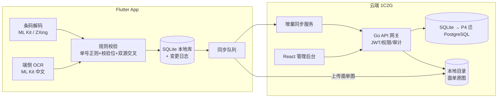

# 包裹管家 PackKeeper — 技术方案（v0.2）

日期：2026-11-24　状态：方案待确认（v0.2 已按 1 核 2GB 服务器约束收缩 OCR 与后端组件）　适用：Windows 开发环境

---

## 1. 需求理解与边界

### 1.1 业务本质
系统管理的不是"包裹"，而是**包裹与（平台 → 账号 → 订单 → 商品）的归属关系**。运单号只是物理世界的入口，真正的资产是归属台账。

### 1.2 四条主链路

| 链路 | 场景 | 关键动作 |
| --- | --- | --- |
| A 到货入库 | 快递集中到货，需要快速登记 | 摄像头扫条形码 → 得运单号 → 生成包裹记录 → 入"待认领池" |
| B 面单留证 | 单号不足以判断 Shop/商品 | 拍照 → OCR → 保存原图 + 结构化字段（快递公司、单号、收件人尾号、地址关键词） |
| C 归属分配 | 不知道包裹属于哪个账号/订单 | 手动选择 平台 → 账号 → 订单/商品；规则与历史记录给候选 |
| D 代下单登记 | 货直接发到第三方地址，不经手 | 先建订单（平台/账号/商品/收货地址）→ 平台下单后人工粘贴物流单号 → 与包裹关联 |

### 1.3 明确不做（合规红线）
- 不存储电商平台账号密码、Cookie、支付信息；
- 不做平台自动登录、不模拟点击、不爬取订单/物流接口；
- 不做"代付/结算"类资金功能（如需对账只做金额记录与导出）；
- 不接入未经授权的第三方数据源。

> 备注：物流轨迹若需要自动更新，只允许对接快递公司/聚合平台的**官方开放接口**并具备相应资质；MVP 不包含。

### 1.4 角色
| 角色 | 权限 |
| --- | --- |
| 负责人（Owner） | 全部数据、账号台账、成员管理、导出、审计 |
| 主管（Manager，可选） | 指定分组内账号与包裹 |
| 员工（Staff） | 仅自己名下账号、自己扫描/认领的包裹 |

---

## 2. 技术选型

### 2.1 移动端（核心）

| 方案 | 优势 | 劣势 | 结论 |
| --- | --- | --- | --- |
| **Flutter + Dart** | 一套代码 iOS/Android；`mobile_scanner`（ML Kit/ZXing）条形码识别成熟；`camera` 可控对焦/曝光/补光；自绘 UI 在大列表、连续扫码场景流畅；SQLite(`sqflite`) 成熟 | 团队若无 Dart 经验需学习；部分国产 ROM 相机兼容需适配 | **推荐（方案 A）** |
| React Native + TypeScript | 与 Web 后台同语言，招人容易；`react-native-vision-camera` + `vision-camera-code-scanner` 可用 | 原生模块版本冲突多；OCR 需 `react-native-ml-kit`，维护活跃度一般；长列表/连续扫码性能调优成本更高 | 备选（方案 B，团队 TS 强时） |
| 原生 Kotlin / Swift | 相机与性能上限最高 | 双端两套代码，人力翻倍 | 仅在只做 Android 且追求极致时考虑 |
| uni-app / 小程序 | 上手快 | 相机连续扫码、离线库、OCR 能力受限，插件质量参差，长期扩展差 | 不推荐作为主客户端 |

### 2.2 后端

| 方案 | 优势 | 劣势 |
| --- | --- | --- |
| **Go（Gin/Echo + GORM/sqlc）** | 单二进制部署、内存占用低、并发处理图片上传/同步游标性能好；容器化简单 | 生态偏"自己写"，业务迭代速度略慢于 TS/Python |
| NestJS（TypeScript） | 与 RN/Web 同语言；DI/模块化规范；Prisma 开发快 | 运行时内存较高；重 CPU 任务需另起服务 |
| FastAPI（Python） | OCR/AI 生态最好 | 作为主业务后端并发与工程规范需额外约束 |
| Spring Boot（Java） | 企业级、权限/审计生态成熟 | 重、启动慢、开发迭代成本高 |

**推荐**：主业务后端 **Go**，**不单独部署 OCR 服务**。硬约束是服务器只有 1 核 2GB：PaddleOCR 运行时常驻约 300–500MB、单核单张推理 1.5–3 秒，与 Go + 数据库抢内存会直接 OOM。因此 OCR 全部下沉到手机端（ML Kit 中文 bundled 模型），服务端只接收结构化结果与原图。RapidOCR(onnxruntime) 仅作为后续可选兜底，非 MVP 范围。

### 2.3 最终推荐组合（方案 A）

```
移动端   Flutter 3.x + Dart            （仅 Android，1080×2400 基准）
端侧识别 ML Kit 条码解码 + ML Kit 中文 OCR（bundled 独立版，离线、无 GMS 可用，APK +约20MB）
本地库   SQLite + sqflite              （离线优先、变更日志；不用 drift 以免引入代码生成）
后端     Go 1.22+ / Gin + sqlc         （REST + JWT + 增量同步接口）
数据库   SQLite（P1 内嵌，零运维）→ PostgreSQL 16（P4 迁移，JSONB + pg_trgm）
文件存储 服务器本地目录 + 限时签名 URL（P4 起可换 OSS/COS）
管理后台 React 18 + TypeScript + Vite + Ant Design
部署     单机二进制直跑（Docker Compose 可选，1C2G 上省 150–200MB）
```

资源约束（1 核 2GB 硬红线）：无 Redis（队列用 DB 表）、无 MinIO（本地磁盘）、无 OCR 微服务。后端常驻内存目标 <300MB，留足系统与数据库余量。

方案 B（全 TypeScript 单语言）：RN + NestJS + Prisma + SQLite→PostgreSQL + 端侧 ML Kit。开发人力门槛低，但扫码性能与离线体验需要更多打磨。

### 2.4 为什么不推荐"一套语言全包"
扫码与 OCR 都是**高频、强交互、强离线**的端侧能力，后台是**重表格与权限**的 Web 能力。端侧用 Flutter/Dart 拿到最好的相机与列表性能，后台用 TypeScript 拿到最快的表单迭代速度，跨语言成本由清晰的 HTTP 契约抵消。而 OCR 因服务器资源受限不下沉服务端，进一步减少了技术栈数量。

---

## 3. 系统架构



关键设计：
- **本地优先**：所有写操作先落 SQLite 并写 `change_log`，UI 立即可用；同步失败不阻塞现场。
- **识别全在端侧**：条码解码 + 面单 OCR + 规则校验都在手机上完成，服务端不做推理，1 核机器只承担 HTTP 与存储。
- **图片走旁路**：面单原图压缩后先本地存，联网后直传服务端本地目录，返回 `media_id`，不占同步带宽。
- **多租户**：所有表带 `org_id`，行级隔离；同步接口强制按 org 过滤。

---

## 4. 数据模型（核心表）

| 表 | 关键字段 | 说明 |
| --- | --- | --- |
| `org` | id, name, plan | 组织（一个负责人一个 org） |
| `member` | id, org_id, name, phone, role, status | 员工/主管/负责人 |
| `platform` | id, org_id, name, code, color | 淘宝/拼多多/京东/1688/抖音…可自建 |
| `platform_account` | id, org_id, platform_id, alias, owner_member_id, login_hint, status, note | **不存密码**，只存账号别名/归属人/备注 |
| `address` | id, org_id, receiver, phone_enc, region, detail_enc, tag | 代下单收件地址，手机/详细地址加密 |
| `purchase_order` | id, org_id, account_id, platform_order_no, amount, ordered_at, address_id, status | 代下单记录 |
| `order_item` | id, order_id, title, sku, qty, shop_name | 商品明细（一单多品） |
| `parcel` | id, org_id, tracking_no, carrier, status, scanned_by, scanned_at, ocr_raw, ocr_fields(JSONB), media_id, assigned_account_id, assigned_order_id | 包裹主表，`tracking_no+carrier` 唯一 |
| `parcel_item_link` | parcel_id, order_item_id, qty | 一个包裹可含多订单商品，多对多 |
| `scan_event` | id, org_id, tracking_no, device_id, operator_id, ts, source(barcode/ocr/manual), raw | 原始扫描流水，用于去重与审计 |
| `audit_log` | id, org_id, actor_id, action, target_type, target_id, before, after, ts | 分配/修改/导出全留痕 |
| `change_log`（端侧） | op_id, entity, entity_id, payload, client_ts, synced | 幂等同步 |
| `sync_cursor` | member_id, device_id, last_server_version | 增量拉取 |

包裹状态机：
```
待认领 → 已分配 → 已入库 → 已出库 → 已完成
            ↘ 异常件（破损/错发/无主）
```

---

## 5. 核心流程

### 5.1 扫码入库（P1 核心）
1. 连续扫码模式：取景框命中 → 解码 → 去抖（同一码 1.5s 内忽略）→ 音效/震动反馈 → 加入列表，**不停留**；
2. 单号规范化：去空格/换行，按快递公司正则校验（顺丰/中通/圆通/韵达/申通/极兔/京东/邮政），校验位可疑时标黄提示；
3. 本地按 `tracking_no + carrier` 去重，重复扫描提示"已入库（谁、何时）"；
4. 提交后批量入"待认领池"。

### 5.2 面单识别（端侧完成）
1. 拍照（引导框 + 自动裁边 + 光照提示）；
2. 端侧 ML Kit 中文 OCR 拿到整面单文本，客户端用本地规则库结构化：
   - 单号：正则库 + 校验位 + **与条码结果交叉验证**（冲突时以条码为准并标黄，人工确认）；
   - 快递公司：面单 logo 关键词 + 单号规则；
   - 收件人：手机号尾号 4 位（脱敏存储）；
   - 地址：省市区关键词匹配 + 收货地址库比对。
3. 原图异步上传服务端存档（不参与识别），保留 `media_id` 供复核与取证；
4. 结构化结果用于**候选推荐**，不自动定归属；所有字段可人工编辑修正。

> 准确率保障主要来自"条码 + OCR + 校验位"三源交叉与规则库，而不是模型精度，因此无需服务端 PaddleOCR。

### 5.3 归属分配
- 待认领池支持：按扫描时间/员工/快递公司筛选，长按多选批量分配；
- 分配面板：平台 → 账号 → 订单（可搜索平台订单号/商品名）→ 商品明细；
- 智能候选（P3）：同账号近期订单、同收件地址、同店铺历史包裹 → 排序展示，一键采用；
- 分配即写 `audit_log`，员工只能分配到自己有权限的账号。

### 5.4 代下单物流登记
1. 建订单：选平台/账号/商品/金额/收货地址（地址库自动带出）；
2. 平台下单完成后，人工把物流单号复制进来（或直接扫快递单）；
3. 系统匹配：若该单号已存在包裹 → 自动关联并流转到"已分配"；否则先建"影子包裹"，到货扫码时自动合并。

### 5.5 云同步
- 上行：`change_log` 批量 push，服务端按 `op_id` 幂等去重，返回新 `server_version`；
- 下行：`pull since=cursor` 增量拉取（含软删除墓碑）；
- 冲突：归属/状态类以**服务端最后写入 + 审计留痕**为准，客户端收到冲突标记提示人工复核；金额类只增不改；
- 会话：JWT（access 15min + refresh 7d），设备绑定，可远程踢下线；
- 开发期**模拟登录**：本地 mock 用户池 + 固定验证码，通过配置开关切换真实短信/SSO。

---

## 6. 扫码与 OCR 技术要点（决定成败的细节）

| 风险点 | 对策 |
| --- | --- |
| 面单褶皱、反光、低光 | 手电筒补光、点击对焦、连续多帧重试、失败降级为"手动输入 + OCR 辅助" |
| 一票多件（子母单） | 记录 `parent_tracking_no`，同主单号自动归组 |
| 条形码与面单印刷单号不一致 | 双源交叉校验，冲突标红人工确认 |
| 国产 ROM 相机权限/对焦异常 | 启动自检 + 备用 ZXing 解码通道 + 机型白名单 |
| OCR 中文准确率 | 端侧 ML Kit 中文 bundled 模型 + 面单专用后处理词典（快递公司名、省市区）；条码与 OCR 双源交叉校验兜底 |
| 隐私 | 原图加密存储、访问签名 URL 限时、手机号仅存后四位用于匹配 |

---

## 7. 安全与合规

- 传输 TLS 1.3；P1 的 SQLite 使用 SQLCipher 加密，P4 的 PostgreSQL 使用磁盘/表空间加密；敏感字段（手机号/详细地址）AES-256-GCM，密钥走环境变量/Vault，不进代码库；
- 面单图片：服务器私有目录 + 限时签名 URL，按组织设置保留期与自动清理（P4 起可迁对象存储私有桶）；
- 账号台账只存"平台 + 别名 + 归属人 + 备注"，杜绝凭证泄露风险；
- 全量审计：谁在何时把哪个包裹分配给了哪个账号，可导出；
- 员工授权：上线前签署账号使用授权书，系统内记录授权时间与范围；
- 数据境内存储，满足《个人信息保护法》最小必要原则。

---

## 8. 里程碑与验收

| 阶段 | 范围 | 验收标准 |
| --- | --- | --- |
| P0 | 方案确认 | 选型/数据模型/边界达成一致 |
| P1 | 单机 MVP | 仓库现场连续扫 200 单无崩溃；断网全程可用；重复单号正确提示；分配后可按账号查询 |
| P2 | 云同步 | 两台设备 5 分钟内数据一致；离线 2 小时后恢复同步无丢失、无重复 |
| P3 | 识别结构化 | 端侧：常见面单单号识别准确率 ≥ 98%，快递公司 ≥ 95%，候选推荐 Top3 命中率 ≥ 70%；服务端零推理负载 |
| P4 | 后台 | 台账/流水/导出/审计可用，权限隔离验证通过 |
| P5 | 硬化 | 加密、脱敏、异常件、灰度发布完成 |

---

## 9. 风险清单

1. **现场网络差** → 本地优先 + 图片延迟上传（已在架构中解决）。
2. **平台规则风险** → 严守"不自动登录、不爬取"红线；只做人工录入。
3. **OCR 长尾差** → 保留人工修正入口，识别结果始终可编辑。
4. **多员工并发认领冲突** → 认领加锁（乐观锁 version），冲突即时提示。
5. **数据合规** → 员工授权留痕 + 敏感字段加密 + 最小化采集。
6. **服务器资源硬约束（1 核 2GB）** → OCR 全部下沉端侧、去掉 Redis/MinIO/OCR 微服务、后端常驻内存目标 <300MB；若后续确需服务端识别，只能上 RapidOCR 轻量版 + 限并发 1 + 2GB swap，且不承诺延迟。

---

## 10. 已确认决策（2026-11-24）

| 决策项 | 结论 |
| --- | --- |
| 技术路线 | **方案 A**：Flutter/Dart 移动端 + Go 后端（无独立 OCR 服务） |
| 客户端范围 | Android 手机（基准 1080×2400），不做平板，首期不做 iOS |
| OCR | **全部端侧**：ML Kit 条码解码 + ML Kit 中文 OCR（bundled 离线版）+ 本地规则校验；不接云 OCR，服务端零推理 |
| 服务端存储 | P1 内嵌 **SQLite**，P4 迁 PostgreSQL 16；文件存服务器本地目录；不用 Redis / MinIO |
| 服务器规格 | 1 核 2GB，作为硬约束反推组件选型（2026-11-24 确认） |

仍待确认：
1. 部署形态：单机 1C2G 二进制直跑（自有服务器 / 内网）还是云托管（云托管同样需满足 1C2G 内存校验）；
2. 员工数据可见范围（仅本人 vs 分组可见）；
3. MVP 效果图的信息层级与操作路径是否认可。

## 11. MVP 界面设计稿

见 `design/mvp-ui.html`：7 屏静态效果图（工作台、扫码入库、面单识别、待认领池、分配归属、账号台账、代下单登记），基准 360×800 dp / 1080×2400 像素。
